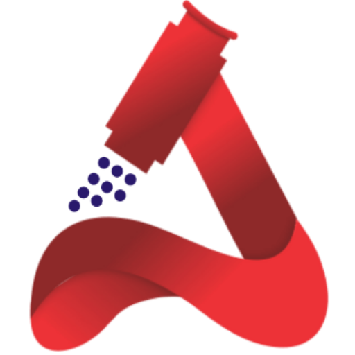
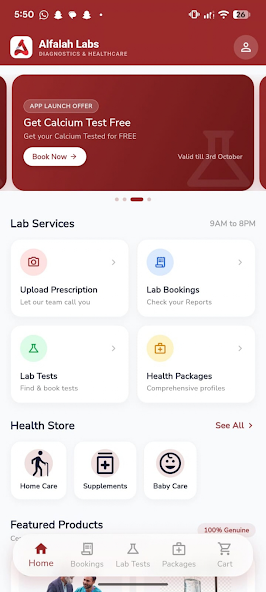
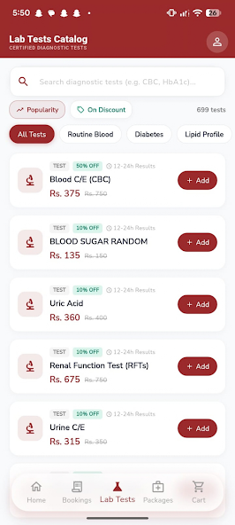
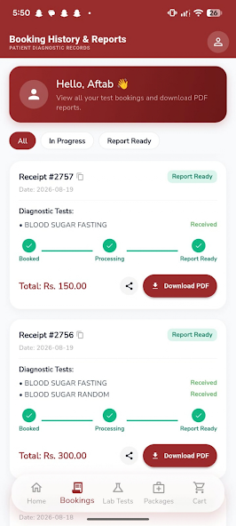
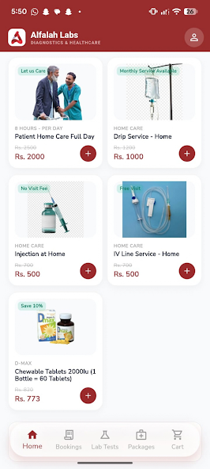
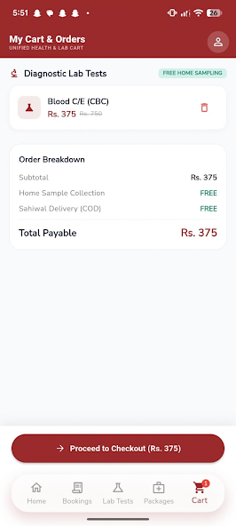
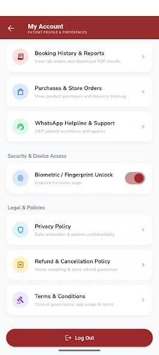

<div align="center">
  

  # Alfalah Labs — Android Patient Application

  **A production Flutter mobile application for Alfalah Diagnostic Labs, enabling patients to book diagnostic tests, upload prescriptions, track sample status, download verified PDF reports, and order healthcare essentials.**

  <p>
    <a href="https://play.google.com/store/apps/details?id=com.alfalahlabs.app">
      
    </a>
    
    
    
    
  </p>
</div>

> **Repository Notice:** The source code, signing keys, and backend configurations for this application are maintained in a private repository for security, clinical data protection, and client privacy. This repository showcases the live product, architecture, implemented features, and user interface.

---

## Live Application

- **Google Play Store:** [Alfalah Labs (`com.alfalahlabs.app`)](https://play.google.com/store/apps/details?id=com.alfalahlabs.app)
- **Official Website:** [alfalahlabs.com](https://alfalahlabs.com)
- **Latest Showcase Version:** `v2.0.8` (Build `11`)
- **Accreditations:** Licensed by Punjab Healthcare Commission (PHC) | NEQAPP Certified

---

## About the Project

The **Alfalah Labs** mobile app brings laboratory diagnostics and patient services into a unified, mobile-first experience connected directly to the Alfalah LIMS backend. Patients can browse hundreds of diagnostic tests and curated health packages, schedule home sample collection for themselves or family members, upload doctor prescriptions, and securely access or share verified PDF lab reports as soon as results are approved.

---

## What Was Built (Key Features)

### Diagnostic Lab Services
- **Searchable Lab Tests Catalog:** Real-time test search, department category filters, default **Popularity** sorting, an **On Discount** quick filter with percentage badges and strikethrough original pricing, turnaround time indicators, and paginated infinite loading.
- **Health Checkup Packages:** Expandable package cards displaying included tests, bundled savings, and isolated package pricing integrity so individual test promotions do not distort package rates.
- **Prescription Upload:** Camera and gallery capture with automatic image compression and optional patient notes, allowing lab staff to review prescriptions and prepare test bookings.
- **Booking History & PDF Reports:** Status filter tabs (`All`, `In Progress`, `Report Ready`), visual three-step progress tracking (`Booked` -> `Processing` -> `Report Ready`), one-tap PDF report viewing/downloading, and native sharing.

### Health & Wellness Store
- **Dynamic Storefront:** Live categories, category drawer navigation, and a 2-column featured products grid displaying product badges, brands, stock availability, and discount pricing.
- **Product Details & Order Tracking:** Dedicated product detail views and full store purchase history tracking fulfillment progress.
- **Unified Cart & Checkout:** Single checkout flow supporting diagnostic tests, packages, and store items with saved **Family Member Profiles**, delivery address details, and special instructions.

### Engagement, Deep Linking & Promotions
- **Dynamic Promotional Carousel:** Backend-driven hero banners with custom gradients, validity indicators, and deep links that open specific test searches directly inside the catalog.
- **Push Notifications (FCM):** Foreground and background notification handling with action routing for Play Store updates, external links, and direct `cart_test` auto-injection from notification taps.
- **In-App Updates:** Integrated Google Play immediate update prompts (`in_app_update`) to keep patients on the latest release.

### Authentication, Security & Compliance
- **Multi-Method Onboarding:** Phone/password authentication, OTP verification, OTP-based password recovery, and 1-tap **Google Sign-In** with phone completion.
- **Biometric Unlock:** Optional on-device fingerprint/biometric authentication (`local_auth`) for fast, secure repeat access.
- **Encrypted Token Storage:** Sensitive authentication tokens persisted with `flutter_secure_storage`.
- **In-App Legal & Governance Suite:** Dedicated Privacy Policy, Refund & Cancellation Policy, Terms & Conditions, and direct WhatsApp Helpline access.

---

## Screenshots

<table>
  <tr>
    <td align="center">
      
      <br><sub><b>Home Dashboard</b><br>Banners, quick actions &amp; store</sub>
    </td>
    <td align="center">
      
      <br><sub><b>Lab Tests Catalog</b><br>Popularity sort &amp; discount filters</sub>
    </td>
    <td align="center">
      
      <br><sub><b>Bookings &amp; Reports</b><br>Live status &amp; PDF download</sub>
    </td>
  </tr>
  <tr>
    <td align="center">
      
      <br><sub><b>Health &amp; Wellness Store</b><br>Products &amp; home care services</sub>
    </td>
    <td align="center">
      
      <br><sub><b>Unified Cart</b><br>Order summary &amp; home sampling</sub>
    </td>
    <td align="center">
      
      <br><sub><b>My Account &amp; Security</b><br>Biometrics, support &amp; policies</sub>
    </td>
  </tr>
</table>

---

## Tech Stack & Architecture

- **Framework & Language:** Flutter 3.x / Dart 3.8+
- **State Management:** `Provider` (`AuthProvider`, `CartProvider`)
- **Networking:** RESTful JSON API client (`http`) synced with Alfalah LIMS backend
- **Authentication & Security:** `google_sign_in`, `local_auth` (biometrics), `flutter_secure_storage`
- **Firebase & Monitoring:** `firebase_core`, `firebase_messaging` (FCM), `firebase_crashlytics`
- **Analytics & Updates:** `facebook_app_events` (non-clinical funnel analytics), `in_app_update`
- **UI & Polish:** Custom Material 3 theme (`#9A2A2B` Brand Maroon, `#10172E` Deep Navy, `#F8FAFC` Off-White), `google_fonts`, `shimmer`, `flutter_animate`, `carousel_slider`
- **Android Target:** `targetSdkVersion 36`, Java 11

### High-Level Module Overview
```text
lib/
├── main.dart            # App bootstrap, Firebase/Crashlytics, FCM deep-link routing
├── providers/           # Centralized Auth and Cart state management
├── services/            # REST API client, on-device Biometrics, Meta App Events
├── screens/             # Auth/OTP, Home, Lab Tests, Packages, Store, Cart/Checkout,
│                        # Prescription Upload, Bookings/Reports, Account & Legal Policies
└── widgets/             # Banner carousel, quick actions, floating cart bar, store grids
```

---

## Links & Contact

- **Download on Google Play:** [https://play.google.com/store/apps/details?id=com.alfalahlabs.app](https://play.google.com/store/apps/details?id=com.alfalahlabs.app)
- **Website:** [https://alfalahlabs.com](https://alfalahlabs.com)
- **Developed by:** [Code & Designs](https://codeanddesigns.com)
